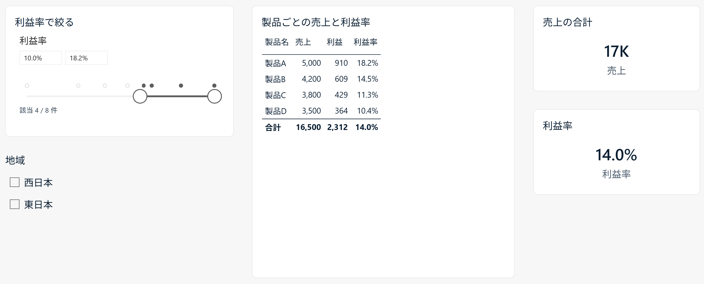

# メジャーのスライサー by itoken lab（Power BI カスタムビジュアル）

利益率などのメジャーの値の範囲で、製品などの列を絞るスライサーです。範囲に合う値の一覧を、その列への絞り込みにしてページに掛けるので、表やグラフに加えてカードにも効きます。



標準のスライサーに入れられるのは列だけです。メジャーの値で絞るには、ビジュアルごとのフィルター（「次の値のときに項目を表示」）を使いますが、効くのはそのビジュアル 1 つだけで、閲覧者がページの上で動かす部品にはなりません。

## インストール

1. [Releases](https://github.com/itoken-lab-jp/measure-slicer/releases)の最新版を開き、「Assets」の `measure-slicer-（版）.pbiviz` をダウンロードします。これがビジュアル本体です。「Source code」のzipは改造する人向けで、取り込みには使いません。
2. Power BI Desktopの「視覚化」ペインで「…」を押し、「ビジュアルをファイルからインポート」を選びます。
3. 取り込んだ「メジャーのスライサー by itoken lab」のアイコンを押し、レポートに置きます。

組織の設定によって、ファイルからのカスタムビジュアルの取り込みが制限される場合があります。

## 使い方

1. 「フィールド」に、絞りたい列（製品名など）を入れます。
2. 「値」に、条件にするメジャー（利益率など）を入れます。列の値ごとのメジャーの値の最小・最大が、入力欄とスライダーの両端になります。
3. 下限・上限に数を打つか、スライダーのつまみを動かします。範囲に合う値だけが、ページのほかのビジュアルに残ります。% の書式のメジャーは、見えている数（10% なら 10）で打ちます。
4. 範囲を外すときは、見出しの右の解除のボタンを押します（マウスを乗せると出ます）。

つまみを動かしている間は、つまみの上に今の値が出ます（書式ペインの「スライダー」の「現在値」）。書式ペインの「分布」をオンにすると、スライダーの上に、列の値ごとのメジャーの値が点で並び、範囲に入ったものが塗られます。値が多いときは、値の幅ごとの件数を棒で出します。

書式ペインの「スライサーの設定」の「スタイル」で、「上位 N」「下位 N」も選べます。件数を打つと、メジャーの値の大きい（小さい）順にその件数を残します。同じ値で並んだものは、両方残します。「合うものを除く」を入れると、合うものを外して残りを通します。

## 気をつけること

- メジャーの値は、ほかのスライサー（期間・地域など）を受けて計算します。ほかのスライサーを変えると、範囲に合う値も入れ替わります。
- 合う値が 0 件のときは、何も通さない絞り込みを掛けます。ほかのビジュアルは空になり、同じテーブル（またはリレーションシップでつながったテーブル）のほかのスライサーは、候補が絞られます。ほかのスライサーを狭めたくないときは、このスライサーを選んでリボンの「書式」タブの「相互作用を編集」を押し、そのスライサーの右上で「なし」を選びます。
- 同期スライサーで同期するのは範囲だけです。スタイル（範囲・上位 N・下位 N）と「合うものを除く」は、ページごとのスライサーの設定のままです。
- 列の値は 30,000 件まで読みます。超えたときは警告のアイコンで知らせ、読めた値だけで絞ります。ビジュアルのフィルターで減らしてください。
- 外部と通信しません。

## 確かめた環境

Power BI Desktop（2.159、2026 年 10 月）で確かめています。Power BI サービスでは確かめていません。

## ソースからビルドする

```
npm install
npx pbiviz package
```

`dist/` に `.pbiviz` ができます。Node.js 20.19 以上と npm が必要です（配布の前のビルドは Node.js 22 と [powerbi-visuals-tools](https://www.npmjs.com/package/powerbi-visuals-tools) 7 系で確かめています）。

## ライセンス・問い合わせ

MIT ライセンスです（[LICENSE](LICENSE)）。商用利用・改変・再配布ができます（無保証）。

不具合の報告と質問は [Issues](https://github.com/itoken-lab-jp/measure-slicer/issues) へお願いします。ほしい機能は、Issues、[note](https://note.com/itoken_lab) のコメント、[X](https://x.com/itokenlab) の DM のどれからでも教えてください。
